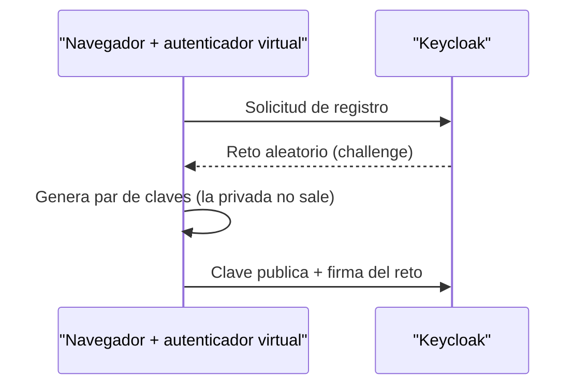
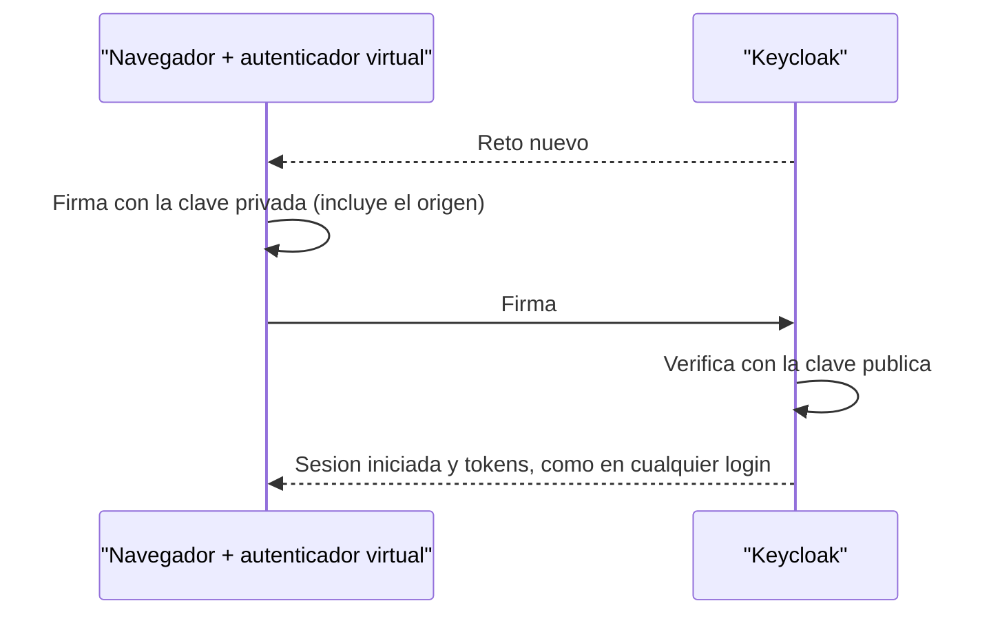
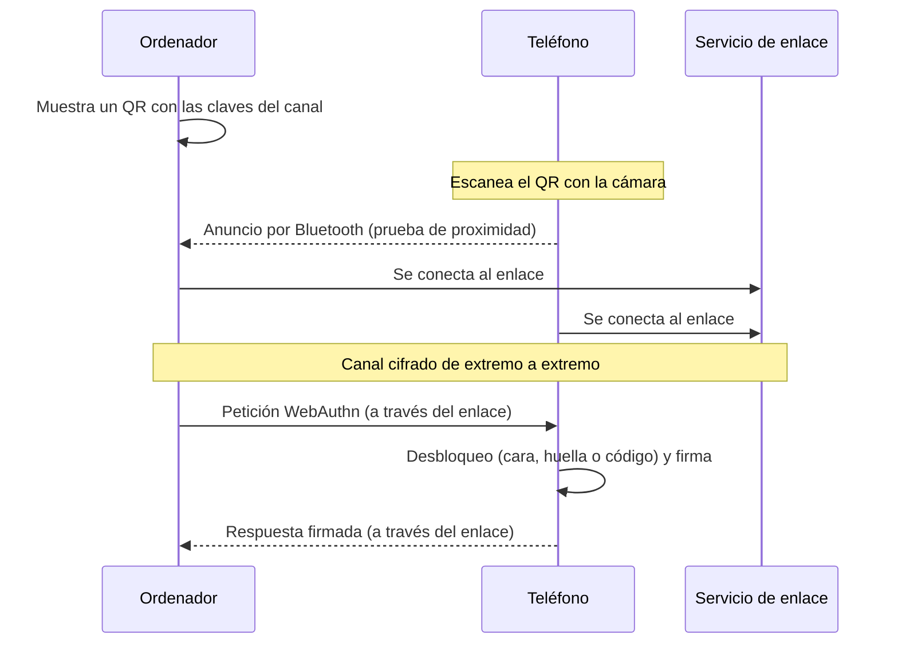

<br/><br/>


# Laboratorio 2: Autenticación sin contraseña con WebAuthn y passkeys

*Curso de Identidad Digital, Autenticación y Autorización — Módulo 2: Autenticación robusta y
criptografía web.*

## Objetivos

Durante décadas, la autenticación ha descansado sobre un secreto compartido: una contraseña que el
usuario conoce y que entrega al servidor para demostrar su identidad. El problema de fondo de ese
modelo es que un secreto que el usuario puede teclear es también un secreto que puede entregar, sin
darse cuenta, a quien no debe. Ni el segundo factor por SMS ni los códigos de un solo uso resuelven
el problema, porque también pueden interceptarse en tiempo real. Esta práctica aborda la alternativa
que la industria ha adoptado para cerrar esa vía: la autenticación criptográfica sin contraseña,
basada en el estándar **WebAuthn**.

Al finalizar la práctica, el estudiante será capaz de:

- Explicar por qué WebAuthn es resistente al *phishing* y qué papel juega el "anclaje al origen".
- Configurar en Keycloak una política de acceso sin contraseña (*passwordless*) basada en passkeys.
- Registrar y utilizar una passkey empleando el autenticador virtual del navegador.
- Razonar sobre qué ocurre cuando una credencial se pierde y sobre la recuperación de cuenta.
- Distinguir entre una passkey vinculada al dispositivo y una passkey sincronizada en un teléfono
  móvil.

## Dependencias

Para realizar la práctica, el alumno deberá tener instalado en su ordenador:

- **Docker** y **Docker Compose** ([instalación](https://docs.docker.com/get-docker/)).
- Los puertos **8080** y **9000** libres. Si el Keycloak del Laboratorio 1 sigue en marcha, deténgalo
  antes, ejecutando `docker compose down` en la carpeta de aquel laboratorio.
- Un navegador basado en **Chromium** (Chrome, Edge o, en Linux, el propio Chromium). El autenticador virtual que se usará es una
  herramienta de las DevTools de Chromium y no está disponible en Firefox ni en Safari.
- Para el apartado 6: un teléfono móvil con gestor de passkeys (iPhone con el Llavero de iCloud, o
  Android con una cuenta de Google) y un ordenador con Bluetooth.

La práctica es independiente del Laboratorio 1: el entorno arranca con todo lo necesario ya creado.

## Descripción de la práctica

Para comprender qué se construye conviene entender primero qué se sustituye. Cuando una persona se
autentica con contraseña, un atacante que logre interponerse —por ejemplo, mediante una página de
*login* falsa que reenvía todo en tiempo real al servidor legítimo— puede capturar tanto la
contraseña como el código de un solo uso y reutilizarlos. El factor adicional no ayuda, porque sigue
siendo un dato que el usuario transmite.

**WebAuthn** elimina esa posibilidad cambiando la naturaleza de la prueba. En el momento del
registro, el dispositivo del usuario (el *autenticador*) genera un par de claves criptográficas: la
clave **privada** se queda dentro del autenticador y no sale jamás; la **pública** se entrega al
servidor. Para iniciar sesión, el servidor envía un reto aleatorio que el autenticador **firma** con
la clave privada, y el servidor verifica esa firma con la pública. Nunca viaja un secreto
reutilizable. Y, de forma crucial, la firma incorpora el **origen** (el dominio) del sitio que la
solicita. Conviene subrayarlo, porque suele malinterpretarse: la resistencia al *phishing* no
proviene de la biometría —la huella o el rostro solo desbloquean el autenticador localmente—, sino
de ese anclaje criptográfico al origen.

Las credenciales así creadas se denominan **passkeys**. En la práctica se recorren dos flujos: el
registro de la passkey y el inicio de sesión con ella.

**Registro.** El autenticador genera el par de claves y entrega la pública a Keycloak:



**Inicio de sesión.** El autenticador firma un reto nuevo y Keycloak lo verifica con la pública.
A partir de ahí todo sigue como con una contraseña: Keycloak abre la sesión y entrega los tokens a
la aplicación. La passkey solo sustituye la forma de demostrar la identidad:



Queda una dificultad práctica: probar passkeys requiere un autenticador (un sensor de huella, un
chip del dispositivo o una llave física), y no todos los equipos disponen de uno. Para que la
práctica sea reproducible en cualquier ordenador, se utilizará el **autenticador virtual** que
incorporan las DevTools de Chromium, que emula por software un autenticador real.

---

## 1. Puesta en marcha y autenticador virtual

El fichero `docker-compose.yml` que acompaña a la práctica arranca Keycloak en modo de desarrollo
(`start-dev`) e **importa al arrancar** el fichero `realm/realm-curso.json`. Ese fichero crea un
realm `curso` con un único usuario, `diego` (contraseña `diego`), con permiso para gestionar su
propia cuenta. Para iniciarlo, copie el fichero de configuración y levante el contenedor:

```bash
cp .env.example .env
docker compose up -d
```

Espere a que la columna de estado indique `healthy` antes de continuar:

```bash
docker compose ps
```

El orden de los pasos que siguen es importante, porque el autenticador virtual se activa por ventana
del navegador y no de forma global. Realícelos tal cual:

1. Abra **primero** una ventana de incógnito (Ctrl+Shift+N) y confirme que Keycloak responde en
   `http://localhost:8080/realms/curso/account/`.
2. **Dentro de esa misma ventana**, abra las DevTools (F12) → menú **⋮** → **More tools** →
   **WebAuthn**.
3. Marque **Enable virtual authenticator environment**.
4. Cree un autenticador virtual con Protocol `ctap2`, Transport `usb`, marque **Supports resident
   keys** y **Supports user verification**, y pulse **Add**.

> **Advertencia.** El autenticador virtual es obligatorio: sin él, un equipo sin sensor biométrico ni
> llave física no podría completar la práctica. Y, puesto que se activa por ventana, si las DevTools
> se abren en una ventana distinta de aquella en la que se inicia sesión, esta última no dispondrá del
> entorno y el navegador intentará recurrir a un teléfono móvil mediante código QR. Por eso se abre
> primero la ventana de incógnito y, dentro de ella, las DevTools.

---

## 2. Activación de las passkeys en el realm

Keycloak ofrece dos políticas distintas basadas en WebAuthn: **WebAuthn Policy** y **WebAuthn
Passwordless Policy**. En esta práctica se utiliza la segunda.

Acceda a la consola de administración (`http://localhost:8080/`, credenciales `admin` / `admin`) →
realm `curso` → **Authentication** → pestaña **Policies** → **WebAuthn Passwordless Policy**:

1. Active **Enable Passkeys**.
2. Compruebe que **Discoverable credential** tiene el valor **Required**, que es el valor por
   defecto. Esta opción exige que la credencial sea *descubrible*: que el propio autenticador sepa a
   qué usuario pertenece, de modo que no sea necesario teclear el nombre de usuario para iniciar
   sesión.
3. Pulse **Save**.

Al activar las passkeys aparece además la opción **Passkey Mediation**, que puede dejarse con su
valor por defecto.

El cambio tiene efectos visibles inmediatos. Si se abre ahora la pantalla de inicio de sesión del
realm, bajo el botón habitual figura una opción nueva, **Sign in with Passkey**, y en la consola de
cuenta de cada usuario aparece la posibilidad de registrar una passkey. Ambas cosas se usarán en los
apartados siguientes.

> **Pregunta.** Antes de seguir, una cuestión de intuición: ¿qué considera más seguro, una passkey
> sola o una contraseña acompañada de un código por SMS (es decir, dos factores)? Razone su
> respuesta; se volverá sobre ella al final del apartado 4.

---

## 3. Registro de la passkey

Se registrará una passkey para el usuario `diego`, actuando como lo haría él mismo desde su portal de
cuenta.

1. En la ventana de incógnito, acceda a `http://localhost:8080/realms/curso/account/` e inicie sesión
   con el usuario `diego` y la contraseña `diego` (todavía con el método tradicional).
2. Vaya a **Account security** → **Signing in**. En la sección **Passwordless**, junto a **Passkey**,
   pulse **Set up Passkey**.
3. Keycloak solicita confirmar el registro. Si pide un nombre para identificar la passkey, indique
   uno cualquiera (por ejemplo, `portatil`). El navegador lanzará entonces el diálogo de WebAuthn,
   que el autenticador virtual resolverá automáticamente.
4. Vuelva a la pestaña **WebAuthn** de las DevTools: figurará ahora una credencial, con su
   **Credential ID** y un contador de firmas (**Sign Count**).

Esa credencial que aparece en el panel es la evidencia visual del concepto central de la práctica.
La clave **privada reside dentro del autenticador** —no en Keycloak, que solo guarda la pública— y
está ligada a este dominio concreto: no serviría en ningún otro sitio.

<details>
<summary><strong>En detalle (opcional):</strong> qué ocurre al registrar la passkey. No es necesario
para continuar.</summary>

Al pulsar **Set up Passkey** ocurre lo siguiente:

1. Keycloak genera un **reto** (*challenge*) aleatorio y llama a `navigator.credentials.create`
   con ese reto, el dominio (`rp.id`), un identificador de Diego y las exigencias de la política.
2. El autenticador comprueba la presencia y la identidad de la persona, genera un **par de
   claves** nuevo para `localhost` y guarda la privada junto con el identificador de Diego.
3. El navegador devuelve a Keycloak dos estructuras. El **`clientDataJSON`** contiene el reto y el
   **origen** de la página (`http://localhost:8080`), añadido por el propio navegador. El
   **`authenticatorData`** contiene un resumen (*hash*) del dominio, unos indicadores
   (*flags*: **UP**, la persona estaba presente; **UV**, fue verificada; **BE** y **BS**, la
   credencial puede sincronizarse y está sincronizada), el **contador** de firmas, el identificador
   de la credencial y la **clave pública**.
4. Keycloak comprueba que el reto es el suyo, que el origen y el dominio son los esperados y que los
   indicadores cumplen la política. Solo entonces **guarda el identificador de la credencial, la
   clave pública y el contador**. Nada más.

El esquema de este flujo es el diagrama de **Registro** de la [Descripción de la práctica](#descripción-de-la-práctica).

</details>

> **Pregunta.** Supóngase que un atacante obtiene una copia completa de la base de datos de
> Keycloak. ¿Qué encontraría en ella sobre la passkey de Diego? ¿Le serviría para suplantarle? Compare
> la situación con la de una contraseña.

> **Dato curioso.** El contador de firmas que muestra el panel sirve para detectar clones. El
> autenticador lo incrementa cada vez que firma, y el servidor guarda el último valor recibido. Si
> llega una firma con un contador igual o inferior al almacenado, es señal de que la clave privada
> podría haberse **clonado**: dos autenticadores estarían usando la misma clave, cada uno con su
> propio contador. Eso sí, muchas passkeys sincronizadas en el móvil envían siempre el valor 0, así
> que el contador es una señal útil, pero no una garantía.

---

## 4. Inicio de sesión sin contraseña

Comprobado el registro, se verifica que el acceso funciona ya sin contraseña:

1. Cierre la sesión de Diego (menú de usuario, arriba a la derecha → **Sign out**).
2. Acceda de nuevo a `http://localhost:8080/realms/curso/account/`.
3. Pulse **Sign in with Passkey**, sin escribir el nombre de usuario. El autenticador virtual
   resolverá el reto y el acceso se completará sin introducir ninguna credencial.
4. Vuelva a la pestaña **WebAuthn** de las DevTools y observe el contador de firmas de la
   credencial.

Keycloak ha sabido quién era el usuario sin que nadie lo tecleara: se lo ha indicado el propio
autenticador, gracias a que la credencial es descubrible.

<details>
<summary><strong>En detalle (opcional):</strong> qué comprueba Keycloak al iniciar sesión. No es
necesario para continuar.</summary>

Al pulsar **Sign in with Passkey**, Keycloak genera un reto nuevo y llama a
`navigator.credentials.get` **sin indicar ningún usuario**. El autenticador busca una credencial
para `localhost`, verifica a la persona y **firma** el reto junto con los datos de la operación.
Con la firma devuelve el identificador de usuario que guardó en el registro: así sabe Keycloak que
se trata de Diego. Antes de aceptar, Keycloak hace cuatro comprobaciones:

1. **Reto:** es el mismo que acaba de generar, de modo que la respuesta no es una repetición de
   otra anterior.
2. **Origen y dominio:** el `clientDataJSON` dice `http://localhost:8080` y el resumen del dominio
   corresponde a `localhost`.
3. **Verificación de usuario:** el indicador **UV** está activo, como exige la política.
4. **Firma:** es válida con la clave pública guardada en el registro.

Además, comprueba que el **contador** ha avanzado respecto al último valor conocido.

El esquema de este flujo es el diagrama de **Inicio de sesión** de la [Descripción de la práctica](#descripción-de-la-práctica).

</details>

> **Pregunta.** Supóngase que Diego recibe un correo con un enlace a una copia exacta de esta
> pantalla de inicio de sesión, alojada en un dominio controlado por un atacante. ¿Qué ocurriría si
> Diego iniciara sesión allí con su contraseña? ¿Y si intentara hacerlo con su passkey? Razone la
> respuesta a partir de lo que contiene la firma. ¿Mantiene la respuesta que dio en el apartado 2?

---

## 5. Verificación: eliminar la credencial

Toda credencial puede perderse o comprometerse, y conviene observar qué ocurre entonces. Elimine la
passkey del autenticador y compruebe el comportamiento:

1. En las DevTools → WebAuthn → elimine la credencial del panel.
2. Cierre la sesión e intente acceder de nuevo con **Sign in with Passkey**: la operación no puede
   completarse.
3. Acceda ahora como Diego con usuario y contraseña tradicionales: funciona sin problema.
4. En la consola de cuenta de Diego → **Signing in**, observe que la passkey **sigue figurando** como
   registrada.

Lo que se ha inutilizado es *un medio* de demostrar la identidad de Diego, no su cuenta ni sus
permisos. El modelo configurado es híbrido: retirar la passkey no deja a nadie fuera mientras la
contraseña siga vigente. Y Keycloak no tiene forma de saber que la clave privada ha desaparecido:
para el servidor, la credencial sigue existiendo. Esto conecta con el problema más delicado de la
autenticación sin contraseña, que es la recuperación de cuenta.

<details>
<summary><strong>En detalle (opcional):</strong> por qué Keycloak no se entera. No es necesario
para continuar.</summary>

En WebAuthn la comunicación siempre la inicia el servidor: el autenticador solo habla cuando se le
pide crear una credencial o firmar un reto. No existe ningún mensaje con el que el autenticador
avise de que ha perdido o borrado una clave. Por eso, para Keycloak, la credencial de Diego sigue
existiendo, y seguirá así hasta que alguien la elimine de la cuenta.

</details>

> **Pregunta.** ¿Qué ocurre si el usuario pierde el dispositivo que contiene la passkey? ¿Qué
> alternativas existen para que no pierda el acceso a su cuenta?

---

## 6. Una passkey en el teléfono móvil

Hasta ahora, la passkey ha vivido en un autenticador simulado y **vinculado** a un único
dispositivo: al borrarlo, la credencial desapareció para siempre. En la práctica, la mayoría de las
personas guardan sus passkeys en el teléfono, dentro del gestor del fabricante (el Llavero de
iCloud en un iPhone, el Gestor de contraseñas de Google en Android), que las **sincroniza** entre
todos sus dispositivos. En este apartado se registra una segunda passkey para Diego, esta vez en su
propio teléfono, mediante el transporte que WebAuthn denomina *hybrid*: el ordenador muestra un
código QR, el teléfono lo escanea y ambos se comunican para completar la operación.

Para este apartado se necesita un **teléfono con bloqueo de pantalla y gestor de passkeys** (un
iPhone con el Llavero de iCloud activado o un Android con una cuenta de Google) y un **ordenador con
Bluetooth activado**. Ambos deben tener conexión a internet.

1. **Desactive el autenticador virtual**: en la pestaña **WebAuthn** de las DevTools, desmarque
   **Enable virtual authenticator environment**. Es imprescindible: mientras el entorno virtual está
   activo, el navegador entrega todas las operaciones de WebAuthn al autenticador simulado y nunca
   ofrece usar el teléfono.
2. Inicie sesión como Diego con usuario y contraseña y, en **Account security** → **Signing in**,
   pulse de nuevo **Set up Passkey**.
3. Esta vez, el diálogo del navegador (o del sistema operativo) ofrece guardar la passkey en otro
   dispositivo, con una opción del tipo "usar un teléfono o tableta". Elíjala: aparece un código QR.
4. Escanee el código con la cámara del teléfono. El teléfono pedirá desbloquearlo (con la cara, la
   huella o el código) y guardará la passkey en su gestor.
5. En **Signing in**, compruebe qué passkeys tiene ahora registradas Diego. Aparecerá también la del
   apartado 5, cuya clave privada ya no existe: elimínela desde la propia consola.
6. Cierre la sesión y acceda con **Sign in with Passkey**, completando la operación desde el
   teléfono.
7. Al terminar, borre la passkey de prueba del teléfono: queda guardada en su cuenta asociada a
   `localhost`. En un iPhone se encuentra en la app **Contraseñas** (en versiones anteriores a
   iOS 18, en **Ajustes** → **Contraseñas**); en Android, en el **Gestor de contraseñas de Google**.

> **Advertencia.** Si al pulsar **Set up Passkey** el navegador solo pide que se inserte una llave de
> seguridad USB y no ofrece usar un teléfono, el ordenador no tiene Bluetooth disponible (es lo
> habitual en equipos de sobremesa, y en Linux, Chromium solo ofrece el teléfono si detecta un
> adaptador Bluetooth activo). En ese caso, realice el apartado junto a un compañero cuyo equipo sí
> disponga de él. Tampoco sirve abrir Keycloak directamente desde el navegador del teléfono: WebAuthn
> solo funciona en `localhost` o con HTTPS, y el teléfono accedería a través de la dirección IP del
> ordenador.

<details>
<summary><strong>En detalle (opcional):</strong> cómo se comunican el teléfono y el ordenador. No es
necesario para continuar.</summary>

El código QR contiene los datos necesarios para que el teléfono y el ordenador establezcan un canal
cifrado entre ellos. El teléfono anuncia su presencia por **Bluetooth**, y el ordenador solo
continúa si lo detecta cerca. Los datos de la operación viajan después, cifrados, por un servicio
de enlace en internet del fabricante. Para Keycloak, el resultado es una passkey como cualquier
otra, con una diferencia visible en el `authenticatorData`: los indicadores **BE** y **BS** aparecen
activos (la credencial es sincronizable y está sincronizada), y el contador suele valer siempre 0.



</details>

> **Pregunta.** El teléfono y el ordenador han tenido que estar cerca, con el Bluetooth activado,
> aunque la información viaja por internet. ¿Qué tipo de ataque impide esa
> comprobación de proximidad?

> **Pregunta.** Compare la passkey del teléfono con la del autenticador virtual. ¿Dónde reside la
> clave privada en cada caso? ¿Qué ventaja y qué riesgo tiene que una passkey se sincronice a través
> de la nube del fabricante? Relaciónelo con la pregunta del apartado 5.

---

## Resolución de problemas

- En los apartados 1 a 5, el navegador ofrece usar el teléfono móvil mediante un código QR → el
  entorno virtual no está activo en esa ventana. Repita el apartado 1 en la misma ventana en la que están abiertas las
  DevTools.
- **Sign in with Passkey** no encuentra ninguna credencial → es probable que no se marcara
  **Supports resident keys** al crear el autenticador virtual. Revíselo, elimine el autenticador,
  cree uno nuevo y repita el registro del apartado 3.
- No aparece **Sign in with Passkey** ni la opción **Set up Passkey** → la política del apartado 2 no
  se ha guardado. Compruebe que **Enable Passkeys** está activado en el realm `curso`, no en `master`.
- `docker compose up` falla porque el puerto 8080 está ocupado → el Keycloak del Laboratorio 1 sigue
  en marcha. Deténgalo con `docker compose down` en la carpeta de aquel laboratorio.
- Para reiniciar el entorno desde cero (se pierde la configuración y las passkeys registradas, y el
  realm se vuelve a importar): `docker compose down -v && docker compose up -d`.
